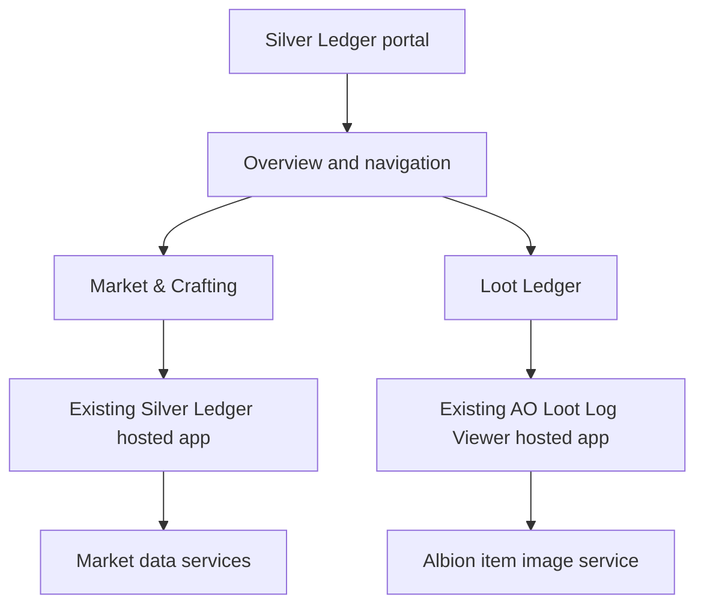

<div align="center">
  

  # ⚒️ SILVER LEDGER
  ### The Merchant's Command Desk

  **Craft with purpose · Trade with insight · Keep every silver accounted for**

  <a href="https://zewo-wo.github.io/Silver-Ledger/">
    
  </a>
  <a href="https://zewo-wo.github.io/ao-loot-log-viewer/">
    
  </a>

  
  
  

  *A tidy guildhall for crafters, traders, guild leaders and loot goblins.*
</div>

---

## 🧭 Your map around the guildhall

Pick a chapter and jump straight to what you need. Each section below can be opened or collapsed so this guide stays easy to explore.

| I want to… | Go to |
|---|---|
| 🏁 Launch the portal | [Quick start](#quick-start) |
| 🖥️ Learn the portal navigation | [Using the command desk](#using-the-command-desk) |
| ⚒️ Calculate crafting and market opportunities | [Market & Crafting guide](#market-crafting-workbench) |
| ⚔️ Import and analyse loot reports | [Loot Ledger guide](#loot-ledger-workbench) |
| 📄 Prepare a compatible CSV | [CSV field guide](#loot-csv-field-guide) |
| 🌐 Put the site on the internet | [Hosting and deployment](#hosting-and-deployment) |
| 🛠️ Change app links or fix a problem | [Configuration and troubleshooting](#configuration-troubleshooting) |
| 🔒 Understand data handling and licenses | [Privacy and notices](#privacy-project-notices) |

> **A quick map before we ride out:** this download is the branded portal. The two workbenches are loaded from their existing hosted websites. Their original code is not bundled into this package, and each app continues to operate independently.

## ✨ What is Silver Ledger?

Silver Ledger brings two Albion Online utilities into one themed landing page:

<table>
  <tr>
    <td width="50%" valign="top">
      <h3>◈ Market & Crafting</h3>
      <p>Plan crafts, estimate costs and returns, compare market information, follow price movement and keep strategies close at hand.</p>
      <a href="https://zewo-wo.github.io/Silver-Ledger/">Enter the Market Desk ↗</a>
    </td>
    <td width="50%" valign="top">
      <h3>⚔ Loot Ledger</h3>
      <p>Load a loot CSV, search records, filter players and locations, compare value summaries and export a focused report.</p>
      <a href="https://zewo-wo.github.io/ao-loot-log-viewer/">Enter the Loot Ledger ↗</a>
    </td>
  </tr>
</table>

### 🗺️ How the pieces connect



**What this means:** the portal is the front door and navigation hub. The Market & Crafting and Loot Ledger tools are embedded from their own GitHub Pages deployments. If an embedded workspace cannot load, use its **Open standalone** link to launch it directly.

---

<a id="quick-start"></a>

## 🚀 Quick start

### Option A — Open the live tools

1. Open the portal at **your deployed domain** after you upload this package, or open either workbench directly using the links below.
2. Choose **Market & Crafting** to plan a craft or inspect market information.
3. Choose **Loot Ledger** to import an Albion loot CSV and explore it.

| Workbench | Direct link |
|---|---|
| ◈ Silver Ledger — Market & Crafting | <https://zewo-wo.github.io/Silver-Ledger/> |
| ⚔ AO Loot Log Viewer — Loot Ledger | <https://zewo-wo.github.io/ao-loot-log-viewer/> |

### Option B — Preview your downloaded package

1. Extract `Silver-Ledger-Merchant-Hub.zip`.
2. Open the extracted `Silver-Ledger-Merchant-Hub` folder.
3. Open `index.html` in a modern browser.
4. For the most reliable local preview, run a small local server from the project folder:

   ```bash
   python -m http.server 8000
   ```

5. Visit <http://localhost:8000>.

> 🌐 **Internet required for the workbenches.** The portal's own layout and artwork are included locally, but the embedded apps and their data/image services are online resources.

---

<a id="using-the-command-desk"></a>

## 🖥️ Using the command desk

The portal has four main destinations. They are controlled from the left navigation on desktop and from the ☰ menu on smaller screens.

<details open>
  <summary><strong>🏠 1. Overview — your guildhall home</strong></summary>

  The Overview is the landing page and starting point.

  **How to use it**
  1. Open the portal's domain.
  2. Read the two workbench cards to choose your task.
  3. Select **Enter Market Desk** or **Review Loot Ledger** in the hero area, or use the matching card action.
  4. Return to Overview from the sidebar at any time.

  **What's on this page**
  - The merchant crest and introduction.
  - A shortcut to each workbench.
  - A short data-handling note explaining browser storage and external services.

</details>

<details>
  <summary><strong>◈ 2. Market & Crafting — the exchange floor</strong></summary>

  Opens the existing Silver Ledger application inside the portal.

  **How to enter**
  1. Select **Market & Crafting** from the sidebar or Overview.
  2. Let the embedded workspace load.
  3. Use the controls inside that application to select an item, item tier/enchantment, quantity, crafting location and the available resource-return/focus settings.
  4. Review the resulting material estimate, market comparison and projected crafting return before committing silver or resources in-game.

  See the [Market & Crafting workbench guide](#market-crafting-workbench) below for a feature-by-feature walkthrough.

</details>

<details>
  <summary><strong>⚔ 3. Loot Ledger — the battlefield record room</strong></summary>

  Opens the existing AO Loot Log Viewer inside the portal.

  **How to enter**
  1. Select **Loot Ledger** from the sidebar or Overview.
  2. Choose **Import CSV** inside the viewer.
  3. Select your Albion Online loot `.csv` file.
  4. Search, filter, sort and switch between the viewer's tabs to inspect the report.
  5. Choose **Export filtered CSV** to download the records matching the current filters.

  The viewer starts empty intentionally. It does not include sample loot records. Read the [Loot Ledger workbench guide](#loot-ledger-workbench) for every view and control.

</details>

<details>
  <summary><strong>✦ 4. About the Hub — project and source information</strong></summary>

  The About page explains the portal's purpose and identifies the two original projects.

  **How to use it**
  1. Select **About the Hub** from the sidebar.
  2. Read each project description.
  3. Select **View source repository** to visit the original GitHub project.
  4. Review the integration note and community-project notice before redistributing or modifying the package.

</details>

### 🧰 Portal controls at a glance

| Control | What it does | How to use it |
|---|---|---|
| Sidebar navigation | Switches between Overview, Market & Crafting, Loot Ledger and About | Select a destination from the left menu. |
| Mobile menu ☰ | Opens or closes navigation on narrow screens | Tap ☰; press `Esc` to close it when using a keyboard. |
| Breadcrumb | Shows which portal section is active | Use it as a quick location indicator. |
| GitHub link | Opens the configured GitHub profile | Select **GitHub ↗** in the top bar. |
| Open standalone | Opens the selected embedded app in its own tab | Use it if the embedded frame is blank, blocked or awkward to use. |
| Reload workspace ↻ | Reloads the selected embedded app | Use it if that app appears stuck or has not finished loading. |
| Remember last section | Stores the last selected portal section in this browser | Reopen the portal in the same browser to return to that section, unless browser storage is cleared or disabled. |
| Footer links | Shows project identity and links back to the GitHub profile | Select the GitHub link in the footer. |

> **Good to know:** the embedded tools are loaded only when you open their section. This keeps the initial portal view lighter and avoids loading both applications immediately.

---

<a id="market-crafting-workbench"></a>

## ◈ Market & Crafting workbench

The Market & Crafting section embeds the [Silver Ledger application](https://zewo-wo.github.io/Silver-Ledger/). The feature guide below describes the toolset represented by the project. Exact control names and layout are owned by the embedded app and may change as that project is updated.

### ⚒️ Feature-by-feature guide

<details open>
  <summary><strong>1. Craft profit calculator</strong></summary>

  Estimate whether crafting an item is economically worthwhile using item selection, material costs, expected returns and market prices.

  **Suggested workflow**
  1. Open **Market & Crafting**.
  2. Select the weapon or armor item you want to evaluate.
  3. Choose the relevant tier and enchantment, where available.
  4. Enter or select the planned crafting quantity and crafting city.
  5. Review the material requirements and cost assumptions.
  6. Check the estimated output value and projected profit/return.
  7. Adjust your assumptions and compare scenarios before crafting in-game.

  **Merchant tip:** treat the result as an estimate. Market orders, taxes, transport risk, listing fees and price movement can change the final silver you receive.

</details>

<details>
  <summary><strong>2. Market and material price lookup</strong></summary>

  Use available city-market information to inspect the estimated cost of materials and the value of crafted items.

  **Suggested workflow**
  1. Pick the item or resource you want to evaluate.
  2. Review the city price information returned by the app.
  3. Compare buying materials in one city with selling or crafting in another.
  4. Refresh the data when you need a more recent quote.
  5. Check the quote's age and source before acting on it.

  Market information depends on the external Albion Online Data Project service. Missing, delayed or unavailable quotes are not a guarantee that an item has no market value.

</details>

<details>
  <summary><strong>3. Tier, enchantment, quantity and crafting city</strong></summary>

  These inputs let you compare different versions and production batches.

  **Suggested workflow**
  1. Choose the item's tier and enchantment.
  2. Set the quantity you intend to craft.
  3. Select the crafting city or location offered by the app.
  4. Compare the calculation after changing one input at a time.
  5. Keep the combination that best matches your actual materials, focus and market plan.

  A small change in tier, enchantment or city can materially change the cost estimate. Double-check the selected variant before relying on a result.

</details>

<details>
  <summary><strong>4. Resource return rate (including focus and city bonuses)</strong></summary>

  Resource return settings estimate how much input material may be returned after crafting. The app includes scenarios involving focus and city crafting bonuses.

  **Suggested workflow**
  1. Open the resource-return or crafting-settings area in the Market & Crafting app.
  2. Set the focus option to match the way you plan to craft.
  3. Select the relevant city bonus or crafting-location scenario, when available.
  4. Recheck the resulting material requirement and profit estimate.
  5. Compare the result with your actual in-game crafting setup.

  Do not assume the highest-return scenario applies to every item or every crafting location. Use the scenario that matches your plan.

</details>

<details>
  <summary><strong>5. Multi-item craft planner and shopping list</strong></summary>

  Plan a batch of different crafts and understand the materials needed across the whole plan.

  **Suggested workflow**
  1. Open the planner area in the Market & Crafting app.
  2. Add each item you intend to craft.
  3. Set the tier, enchantment and quantity for each line, where available.
  4. Review the combined material requirements or shopping list.
  5. Compare the total planned cost with your available resources and silver.
  6. Adjust quantities and remove items you no longer intend to craft.

  **Merchant tip:** use the shopping list to prepare one purchasing route, but refresh prices before buying.

</details>

<details>
  <summary><strong>6. Market price trends and city arbitrage</strong></summary>

  Use price history and city comparisons to investigate how prices move and where a potential buy-low/sell-high opportunity may exist.

  **Suggested workflow**
  1. Choose an item to investigate.
  2. Open the trend or history view available in the app.
  3. Select or compare the relevant cities and time range, if those filters are available.
  4. Look for changes in price and differences between cities.
  5. Estimate transport costs, taxes, listing fees and time before deciding whether the spread is worthwhile.

  A price gap is not guaranteed profit. Check whether the prices are recent and whether there is enough market volume to complete the trade.

</details>

<details>
  <summary><strong>7. Price fluctuation alerts and notifications</strong></summary>

  Track price movement using alert rules supported by the app.

  **Suggested workflow**
  1. Open the alerts or price-monitoring area.
  2. Select the item you want to watch.
  3. Set the available threshold or fluctuation condition.
  4. Save or enable the alert using the app's own controls.
  5. Allow browser notifications if the app requests permission and you want desktop/browser alerts.
  6. Review or adjust your alert rules as market conditions change.

  Notifications depend on browser permissions, app behavior and the availability of market data. A notification is a signal to investigate, not an automatic trade instruction.

</details>

<details>
  <summary><strong>8. Saved strategies and local strategy vault</strong></summary>

  Keep reusable crafting or trading assumptions in the app's browser-based strategy storage.

  **Suggested workflow**
  1. Prepare a calculation or plan you want to reuse.
  2. Open the strategy or saved-plan area.
  3. Use the app's save action and provide a recognizable name, if prompted.
  4. Reopen the saved entry when you want to revisit its assumptions.
  5. Update or remove old entries using the available controls.

  These saved settings are associated with the browser/app storage, not a Silver Ledger account synced by this portal. Clearing site data or changing browsers may remove access to locally saved information.

</details>

### 🧠 A sensible merchant routine

1. **Check prices** before you buy materials.
2. **Calculate returns** with the correct city, focus and resource-return assumptions.
3. **Plan the batch** so you know your total material requirements.
4. **Compare trends** and city differences, rather than relying on one quote.
5. **Save the strategy** if you expect to repeat the same craft.
6. **Recheck the market** before committing silver in-game.

---

<a id="loot-ledger-workbench"></a>

## ⚔ Loot Ledger workbench

The Loot Ledger section embeds the [AO Loot Log Viewer](https://zewo-wo.github.io/ao-loot-log-viewer/). It is a browser-based viewer for loot reports exported as CSV. It does not come preloaded with player records or sample loot.

### 📥 First import — from file to field report

1. Open **Loot Ledger** from the portal.
2. Select **Import CSV** inside the viewer.
3. Choose your Albion Online loot `.csv` file.
4. Wait for the viewer to parse the file and populate its summaries and records.
5. Use the search box and filters to narrow the report.
6. Switch between **Loot log**, **Top items**, **Player stats** and **Player loot** to explore the data.
7. Select **Export filtered CSV** when you want to download the records currently matching your filters.

> The dashboard starts empty by design. Import a report to populate it. The viewer's published documentation says the selected CSV is processed in your browser rather than uploaded to the project's server.

### 🔎 Every Loot Ledger feature

<details open>
  <summary><strong>1. Import loot CSV 📥</strong></summary>

  Load a report from your computer.

  **Steps:** select **Import CSV**, choose the `.csv` report, and wait for the viewer to process the rows. The file must include the required `item_id` and `item_name` columns. See the [CSV field guide](#loot-csv-field-guide) before importing a custom export.

</details>

<details>
  <summary><strong>2. Search 🔍</strong></summary>

  Search across item, player, guild, cluster and related loot details.

  **Steps:** click the search field, type a distinctive word or name, then review the matching records. Clear or replace the search text to broaden the results. Search works together with the other filters and across the main views.

</details>

<details>
  <summary><strong>3. Player / looter filter 👤</strong></summary>

  Show records associated with one looter or return to the full report.

  **Steps:** open the **All looters** selector, choose a player, and inspect the filtered results. Choose **All looters** again to remove that filter.

</details>

<details>
  <summary><strong>4. Guild filter 🏰</strong></summary>

  Narrow the report to a looter's guild. The selected guild filter also applies when switching between the viewer's other main views.

  **Steps:** open the **Guild** selector, choose the guild you want to inspect, and change views without clearing the filter. Select the all-guild option to reset it.

</details>

<details>
  <summary><strong>5. Cluster filter 🗺️</strong></summary>

  Narrow records to a specific cluster or location.

  **Steps:** open **All clusters**, choose the target cluster and review the remaining records. Combine this with search and player/guild filters to inspect a particular run or group.

</details>

<details>
  <summary><strong>6. Sort records ↕️</strong></summary>

  Change the order of the loot records.

  **Available sort choices:** newest, estimated value, quantity or item name.

  **Steps:** open the sort selector and choose the order that answers your question. For example, sort by estimated value to inspect high-value records first, or by newest to review the latest rows.

</details>

<details>
  <summary><strong>7. Loot log 📜</strong></summary>

  The record-by-record view displays the imported loot entries and their available details, such as item, looter, source, location, quantity, estimated value and UTC timestamp.

  **Steps:** select **Loot log**, apply search and filters, then browse the rows. Use **Previous** and **Next** controls when the results span multiple pages.

</details>

<details>
  <summary><strong>8. Top items 💎</strong></summary>

  Summarizes items by their estimated contribution to the loot value.

  **Steps:** select **Top items** after importing a report. Review the items with the largest estimated values. Apply search and filters first to focus the summary on a player, guild or cluster where needed.

  Values are based on the information in the imported CSV; they are not live market quotes.

</details>

<details>
  <summary><strong>9. Player stats 📊</strong></summary>

  Compares players using estimated loot value and item counts.

  **Steps:** select **Player stats** and compare the totals for players in the currently filtered report. Apply guild or cluster filters to focus on a smaller group.

</details>

<details>
  <summary><strong>10. Player loot 🎒</strong></summary>

  Groups loot by player and guild in an inventory-style view.

  **Steps:** select **Player loot** and browse each player's grouped items. Item icons wrap onto additional rows when needed. Quantity badges indicate the total quantity for that item. On desktop, hover over an icon to view its item name, quantity and estimated value when available.

</details>

<details>
  <summary><strong>11. Death styling ☠️</strong></summary>

  The player loot card receives a red visual treatment when the CSV's `died` field indicates a death. Otherwise, it keeps its standard dark appearance.

  **Steps:** include the `died` column in your CSV and populate it according to the source report. The current app logic recognizes values such as `true`, `yes`, `dead`, `died`, `1`, or a positive numeric value. A positive numeric value may also be shown as compact death fame.

</details>

<details>
  <summary><strong>12. Export filtered CSV 📤</strong></summary>

  Download only the rows that match the current search and filters.

  **Steps:** import a report, apply the filters you need, confirm that matching records remain, then select **Export filtered CSV**. The export control is disabled when no records match. Other CSV columns are retained when filtered records are exported.

</details>

### 🧩 Filters work together

For example, to review a particular guild member's loot in one cluster:

1. Import your report.
2. Select the player in **All looters**.
3. Select their guild in **Guild**.
4. Select the area in **All clusters**.
5. Enter an item name in Search if you need to narrow it further.
6. Review the Loot log, Top items or Player stats view.
7. Export the filtered records if you need a separate file.

---

<a id="loot-csv-field-guide"></a>

## 📄 Loot CSV field guide

The Loot Ledger viewer accepts comma-separated and semicolon-separated CSV files and supports quoted values.

### Required fields — the gatekeepers

Both column headers must be present. If either is missing, the import is rejected.

| Column | Required? | What it is used for |
|---|:---:|---|
| `item_id` | ✅ Yes | Item identifier used to request the Albion item icon. |
| `item_name` | ✅ Yes | Readable item name displayed in the report. |

### Recommended fields — extra detail for better reports

| Column | Recommended use |
|---|---|
| `timestamp_utc` | Record time and newest-first sorting. |
| `looted_by__name` | Player name and player filter. |
| `looted_by__guild` | Guild name and guild filter. |
| `cluster` | Cluster filter and location display. |
| `quantity` | Item quantities and grouped totals. |
| `average_est_market_value` | Estimated loot value calculations. |
| `quality` | Item icon quality, when supplied. |
| `enchantment` | Enchantment level, when supplied. |
| `died` | Death styling and optional death-fame display. |
| `looted_from__name` | Name of the player or entity the loot came from. |
| `looted_from__guild` | Source guild. |

Other CSV columns are retained when filtered records are exported.

### 🧪 Example CSV layout

The example below uses semicolons between columns. Replace the sample rows with your own report data.

```csv
item_id;item_name;timestamp_utc;looted_by__name;looted_by__guild;cluster;quantity;average_est_market_value;quality;enchantment;died;looted_from__name;looted_from__guild
T4_BAG;Adept's Bag;2026-11-20T12:30:00Z;PlayerOne;Silver Traders;Thetford;1;12000;1;0;false;EnemyOne;Red Guild
T5_CAPE;Expert's Cape;2026-11-20T12:35:00Z;PlayerTwo;Silver Traders;Bridgewatch;2;18000;2;1;false;EnemyTwo;Blue Guild
```

### 🧹 CSV preparation checklist

- [ ] Save/export the file as `.csv`.
- [ ] Include the exact `item_id` and `item_name` header names.
- [ ] Keep underscores and spelling in column headers unchanged.
- [ ] Use numeric values for `quantity` and `average_est_market_value`.
- [ ] Keep player and guild names consistent so records group together cleanly.
- [ ] Use item IDs with enchantment suffixes such as `@1`, `@2` or `@3` when supplied by your data source. Separate `quality` and `enchantment` columns are also supported.
- [ ] Check that the file does not contain private information you do not want to process or share.

**Where did my market value come from?** The loot viewer's estimated values are read from your imported CSV. They are not live market prices. A newer or more accurate source report may produce different totals.

---

<a id="hosting-and-deployment"></a>

## 🌐 Hosting and deployment

This package is a static website. The portal shell does not require Node.js, PHP, a database or a build command.

### 🏠 Shared hosting / cPanel / FTP

1. Download `Silver-Ledger-Merchant-Hub.zip`.
2. Extract it on your computer.
3. Open your hosting provider's **File Manager** or connect through FTP/SFTP.
4. Navigate to the website document root — commonly `public_html/`, `www/` or `htdocs/`.
5. Upload the **contents** of the extracted `Silver-Ledger-Merchant-Hub` folder into that directory.
6. Confirm that `index.html` is directly inside the document root.
7. Keep the `css/`, `js/` and `assets/` folders beside `index.html`.
8. Open your domain and test both workbenches.

### ☁️ Netlify / Cloudflare Pages / Vercel

1. Create a new static website project.
2. Upload the extracted project folder or connect a Git repository containing it.
3. Set the project root (the directory containing `index.html`) as the publish directory.
4. Leave the build command empty / not set.
5. Deploy and open the generated site URL.

### 🐙 GitHub Pages

1. Create or open the GitHub repository where you want to host the portal.
2. Upload the project files and folders to the publishing location.
3. Open **Settings → Pages**.
4. Select the branch and folder that contain `index.html`.
5. Save the Pages settings and wait for the deployment to complete.
6. Open the published URL and test the links and workspaces.

### ✅ After-deployment checklist

- [ ] The landing page displays the merchant crest.
- [ ] The sidebar changes between all four sections.
- [ ] The mobile menu opens and closes on a narrow screen.
- [ ] Market & Crafting loads in its embedded frame.
- [ ] Loot Ledger loads in its embedded frame.
- [ ] Both **Open standalone** links work.
- [ ] Both **Reload workspace** buttons reload their corresponding app.
- [ ] The browser address uses HTTPS when your host supports it.

---

<a id="configuration-troubleshooting"></a>

## ⚙️ Configuration & troubleshooting

### Change the hosted app addresses

Edit `js/config.js`. This is the only configuration file needed to change the embedded application destinations and GitHub profile link.

```js
window.SILVER_LEDGER_CONFIG = Object.freeze({
  marketUrl: 'https://zewo-wo.github.io/Silver-Ledger/',
  lootUrl: 'https://zewo-wo.github.io/ao-loot-log-viewer/',
  githubProfile: 'https://github.com/zewo-wo'
});
```

- `marketUrl` — destination for the Market & Crafting iframe and its standalone link.
- `lootUrl` — destination for the Loot Ledger iframe and its standalone link.
- `githubProfile` — destination used by the portal's GitHub links.

Use complete HTTPS URLs, keep the trailing slash where applicable, save the file and upload the changed `js/config.js` to your host.

### 🛠️ Troubleshooting table

<details open>
  <summary><strong>The portal opens, but an embedded app is blank</strong></summary>

  - Select **Open standalone** beside the affected workspace.
  - Confirm the original hosted app loads directly.
  - Check whether your browser, privacy extension, workplace network or content blocker prevents iframe content.
  - Confirm the URL in `js/config.js` is correct.
  - Some hosted apps or hosting providers may restrict being displayed inside another page. In that case, use the standalone link or update the source app's embedding policy.

</details>

<details>
  <summary><strong>The portal layout appears, but the crest or icons are missing</strong></summary>

  - Confirm the complete `assets/` folder was uploaded.
  - Check that `assets/brand-crest.webp`, `assets/favicon.png` and the other filenames retain their exact spelling and capitalization.
  - Confirm `css/styles.css` and `js/app.js` are uploaded in their folders.
  - Hard-refresh the browser after uploading updated assets.

</details>

<details>
  <summary><strong>The Market & Crafting app shows missing or old prices</strong></summary>

  - Use the app's own refresh controls.
  - Check your internet connection and whether the Albion Online Data Project service is available.
  - Verify the selected item and city.
  - Remember that market data can be delayed or incomplete and is not guaranteed to represent an executable order.

</details>

<details>
  <summary><strong>The Loot Ledger is empty or the CSV import fails</strong></summary>

  - The viewer starts empty; import a report to populate it.
  - Confirm the file ends in `.csv`.
  - Confirm both `item_id` and `item_name` headers are present and spelled exactly as shown.
  - Check that the header row is not missing or replaced by a title row.
  - Check whether your CSV uses commas or semicolons consistently.
  - Try opening the file in a spreadsheet editor to inspect malformed rows or unusual quoting.

</details>

<details>
  <summary><strong>My saved portal section or strategy is gone</strong></summary>

  - The portal's last-view preference uses this browser's `localStorage`.
  - The market app also uses browser storage for its local preferences, plans, alerts, strategies and cached data as described by the project.
  - Clearing website data, using private browsing, switching browsers or changing devices may remove or hide locally saved information.

</details>

<details>
  <summary><strong>Changes are not appearing after I upload new files</strong></summary>

  - Confirm you uploaded files to the correct document root or publishing folder.
  - Confirm `index.html` is at the root of the published site.
  - Hard-refresh the page or open it in a private window to bypass cached files.
  - For GitHub Pages or another deployment service, confirm the latest deployment completed successfully.

</details>

---

<a id="privacy-project-notices"></a>

## 🔒 Privacy & project notices

### What stays in your browser?

- **Portal navigation:** the last selected portal section is saved in the browser's `localStorage` under `silverLedgerPortalLastView`.
- **Loot CSV:** the Loot Viewer documentation says the selected CSV is read in the browser and is not uploaded to the project's server. Imported records remain in the current page session; import the file again after reloading.
- **Market workspace:** the Silver Ledger project uses browser storage for local preferences, plans, alerts and cached market data.

### What may contact external services?

- **Market data:** the Market & Crafting app requests quotes and history from Albion Online Data Project endpoints. Freshness and availability depend on that external service.
- **Loot item art:** the Loot Viewer requests item images from `https://render.albiononline.com/v1/item/`. Item IDs and image request details are sent to that service as part of loading the icon.
- **Embedded applications:** the portal loads both workbenches from their separate GitHub Pages origins. Their storage and permissions remain scoped to those origins.

Your loot CSV may include player names, guild names and loot history. Be thoughtful before sharing, publishing or attaching a report to a public issue. The portal itself does not provide a shared account system or a server-side database.

### 📜 Licensing and affiliation

- The AO Loot Log Viewer repository identifies its source code and documentation as **GNU GPL-3.0**. Review its [LICENSE](https://github.com/zewo-wo/ao-loot-log-viewer/blob/main/LICENSE) before copying or redistributing that source.
- The Silver Ledger repository's public root listing did not expose a license file when this package was prepared. Do not assume its source code is available for redistribution; verify the current repository license or obtain permission before incorporating it into a combined codebase.
- This portal package contains its own portal shell, styles, configuration and generated merchant artwork. It does not bundle either embedded app's source code.
- Albion Online, its artwork, logos, game assets and trademarks belong to their respective rights holders. Silver Ledger is an unofficial fan-made project and is not affiliated with, endorsed by or sponsored by Sandbox Interactive GmbH.

See [`THIRD_PARTY_NOTICES.md`](THIRD_PARTY_NOTICES.md) for the package's third-party notices.

---

## 📂 Project map

```text
Silver-Ledger-Merchant-Hub/
├── index.html                  # Portal structure and workspace sections
├── README.md                   # This field guide
├── THIRD_PARTY_NOTICES.md      # External projects, services and notices
├── .htaccess                   # Apache hosting rules (if supported by host)
├── css/
│   └── styles.css              # Responsive dark bronze / silver / teal theme
├── js/
│   ├── app.js                  # Navigation, embedded app loading and UI behavior
│   └── config.js               # Hosted app and GitHub profile URLs
└── assets/
    ├── brand-crest.webp        # Original fantasy merchant brand artwork
    ├── favicon.png             # Browser tab icon
    ├── apple-touch-icon.png    # Apple home-screen icon
    └── pwa-icon.png            # Installable-app icon artwork
```

### 🎨 Brand palette and identity

| Element | Role |
|---|---|
| Obsidian / charcoal | Main background and workspace surfaces. |
| Antique gold / bronze | Merchant identity, trim and primary actions. |
| Silver / ivory | Headings and readable text. |
| Muted teal | Status accents and secondary highlights. |

The included merchant crest is original generated artwork created for this portal using the supplied icon as visual inspiration. The reference image itself is not copied into the deployed brand assets.

---

## 🤝 Project links

| Destination | Link |
|---|---|
| Silver Ledger source | <https://github.com/zewo-wo/Silver-Ledger> |
| Silver Ledger live app | <https://zewo-wo.github.io/Silver-Ledger/> |
| AO Loot Log Viewer source | <https://github.com/zewo-wo/ao-loot-log-viewer> |
| AO Loot Log Viewer live app | <https://zewo-wo.github.io/ao-loot-log-viewer/> |
| Maintainer GitHub profile | <https://github.com/zewo-wo> |

---

<div align="center">

  ### 🪙 May your margins be high and your bags be full.

  **SILVER LEDGER**  
  *Craft with purpose. Trade with insight.*

  ⚒️ · ◈ · ⚔️

</div>
